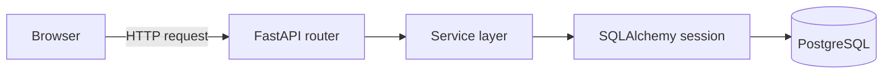

# API architecture and data flow

This guide explains how a request moves through Suot API and how each user's data stays separate. For setup, endpoints, and current limitations, see the [API guide](API.md).

## System structure

The Next.js frontend sends HTTP requests directly to FastAPI. The backend handles authentication and database access.



| Layer | Responsibility | Example |
| --- | --- | --- |
| Router | Receive requests, resolve dependencies, and return HTTP responses | [Item routes](../app/routers/items.py) |
| Schema | Define and validate request/response data | [Item schemas](../app/schemas/item.py) |
| Service | Run queries, apply ownership rules, and save changes | [Item service](../app/services/item_service.py) |
| Model | Define database columns and constraints | [Item model](../app/models/item.py) |

This separation keeps HTTP handling in routers and database operations in services. Services receive a database session and values such as `user_id`; they do not resolve FastAPI dependencies themselves.

## Example: creating an item

For `POST /items`:

1. FastAPI validates the JSON body using `ItemCreate` and resolves the database and authenticated-user dependencies.
2. [`get_current_user`](../app/routers/auth.py) verifies the Bearer token's signature and expiration, then loads the user identified by its `sub` claim.
3. The router calls `create_item` with the validated fields and `current_user.id`.
4. The service creates an `ItemModel`, commits the database transaction, and refreshes the saved record.
5. FastAPI serializes the result through the `Item` response schema, including the assigned item ID and owner ID.

The client sends clothing details, the backend assigns ownership. Other item operations follow the same router-to-service pattern.

## Authentication and ownership

[`security.py`](../app/security.py) hashes passwords with Argon2 and signs JWT access tokens. Login checks the password and returns a token containing the user's ID and an expiration time. Protected routes resolve that token to a database user before accessing their items.

The database relationship is:

```text
users.id → items.user_id
One user owns many items; each item has one owner.
```

Private item queries include `ItemModel.user_id == user_id`, where `user_id` comes from the authenticated user. Detail, update, and delete lookups require both the item ID and owner ID. Lists, counts, and statistics also filter by owner.

These are application-level ownership checks. A foreign key links items to valid users, but does not enforce which caller may access them. Missing items and another user's items both return 404.

## Filtering, pagination, and statistics

The item service applies list queries in this order:

```text
Owner → filters → optional sorting → limit and offset
```

`get_items` returns the page. `count_items` reuses the same filters without pagination to calculate `total`. The router sets `has_more` using `offset + len(items) < total`.

`get_item_stats` reads the user's whole closet, independently of list filters and pagination. It calculates counts, total value, and the most expensive item in Python. This keeps the calculation straightforward, but loads all of that user's items into memory.

## Database lifecycle and testing

[`database.py`](../app/database.py) creates the SQLAlchemy engine and provides a session for each request that needs database access. The dependency closes the session afterward. Services commit writes; opening a session alone does not save changes.

SQLAlchemy models describe tables. [Alembic](../alembic/env.py) applies versioned schema changes; starting the API does not create or migrate tables automatically. Prices use `Numeric(10, 2)` and Python `Decimal`, with strings in JSON responses to preserve their decimal representation.

The [API tests](../tests/test_items.py) replace the database dependency with a SQLite session and recreate tables from model metadata. This makes API behavior and ownership checks easy to test without a running PostgreSQL server. It does not verify PostgreSQL-specific behavior or Alembic migrations.
